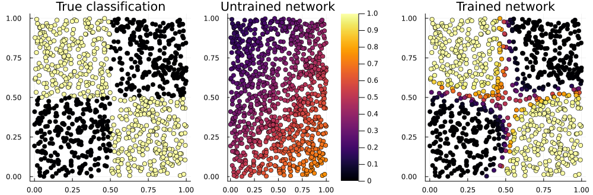

# [A Neural Network in One Minute](@id man-quickstart)

Train a small neural network to predict which points in a unit square have exactly one coordinate greater than 0.5. This is the XOR classification problem.

For a step-by-step introduction to models and training, start with [Fitting a Straight Line](overview.md).

## Train on CPU

Install Flux with `] add Flux` at the Julia prompt, then run this example.

```julia
using Flux, Random

Random.seed!(42)
x_train = rand(Float32, 2, 1024)
x_test = rand(Float32, 2, 256)
xor_labels(x) = [xor(a > 0.5f0, b > 0.5f0) for (a, b) in eachcol(x)]
classes = [true, false]
y_train = Matrix{Float32}(Flux.onehotbatch(xor_labels(x_train), classes))
y_test = xor_labels(x_test)

device = cpu_device()
model = Chain(Dense(2 => 8, tanh), Dense(8 => 2)) |> device
scores_before = cpu(model)(x_test)  # for the plot below

loader = Flux.DataLoader((x_train, y_train); batchsize=64, shuffle=true) |> device
loss(m, x, y) = Flux.logitcrossentropy(m(x), y)
opt_state = Flux.setup(Adam(0.01f0), model)

for _ in 1:100
    Flux.train!(loss, model, loader, opt_state)
end

scores_after = cpu(model)(x_test)
predictions = Flux.onecold(scores_after, classes)
accuracy = sum(predictions .== y_test) / length(y_test)
```

`Flux.train!` runs one epoch. It computes a gradient and updates the model for each batch, using the optimiser state created by `Flux.setup`. The last three lines evaluate the trained model on a separate test set.

## Train on a GPU or with Reactant

Replace `device = cpu_device()` in the example with one of the blocks below and run it again. The example moves the model before `Flux.setup`, transfers one batch at a time, and uses `cpu(model)` to evaluate on the CPU.

### Native GPU backends

For an NVIDIA GPU, install the packages with `] add CUDA cuDNN` and select the device.

```julia
using CUDA, cuDNN
device = gpu_device(force=true)
```

On AMD GPUs, install and load `AMDGPU`. On Apple Silicon, install and load `Metal`. Use the same `gpu_device` call after loading the package for your hardware. See the [GPU guide](../gpu.md) for setup details.

### Compiled training with Reactant

Install Reactant with `] add Reactant` and select a Reactant device.

```julia
using Reactant
device = reactant_device()
```

`Flux.train!` compiles the first training step and reuses it for the fixed-size batches in this example. Reactant can run the compiled step on CPU or a supported accelerator. See the [Reactant guide](../reactant.md) for device configuration and compiled inference.

## Features to Note

* The batch dimension comes last. The `2×1024` training matrix holds 1024 observations, one per column.
* The model is callable as `model(x)`. Each [`Dense`](@ref Flux.Dense) layer stores its own parameters. The final layer produces two scores per observation, one for each class. [`logitcrossentropy`](@ref Flux.Losses.logitcrossentropy) takes these scores and the one-hot targets.
* Use [`trainstep!`](@ref Flux.Train.trainstep!) to update the model one batch at a time and read the loss. The [training guide](@ref man-training) shows how to log metrics, write a custom loop, and schedule the learning rate.

To start from pretrained weights, see [Metalhead.jl](@ref man-pretrained-models).

## Plot the predictions

The panels show the XOR labels and the predicted probability of `true` before and after training.



To plot your own results, install Plots with `] add Plots`. The first row of `softmax(scores; dims=1)` gives the probability of `true`, the first class in `classes`.

```julia
using Plots

prob_before = softmax(scores_before; dims=1)[1, :]
prob_after = softmax(scores_after; dims=1)[1, :]
x1, x2 = x_test[1, :], x_test[2, :]
p_true = scatter(x1, x2; marker_z=y_test, title="True classification", legend=false)
p_raw = scatter(x1, x2; marker_z=prob_before, title="Untrained network", clims=(0, 1), legend=false)
p_done = scatter(x1, x2; marker_z=prob_after, title="Trained network", clims=(0, 1), legend=false)
plot(p_true, p_raw, p_done; layout=(1, 3), size=(1000, 330))
```
